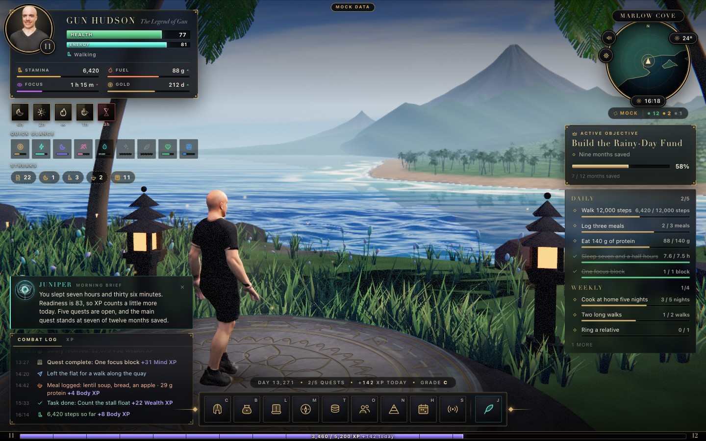
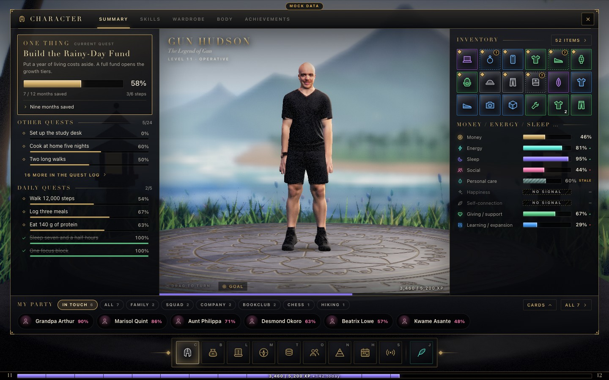
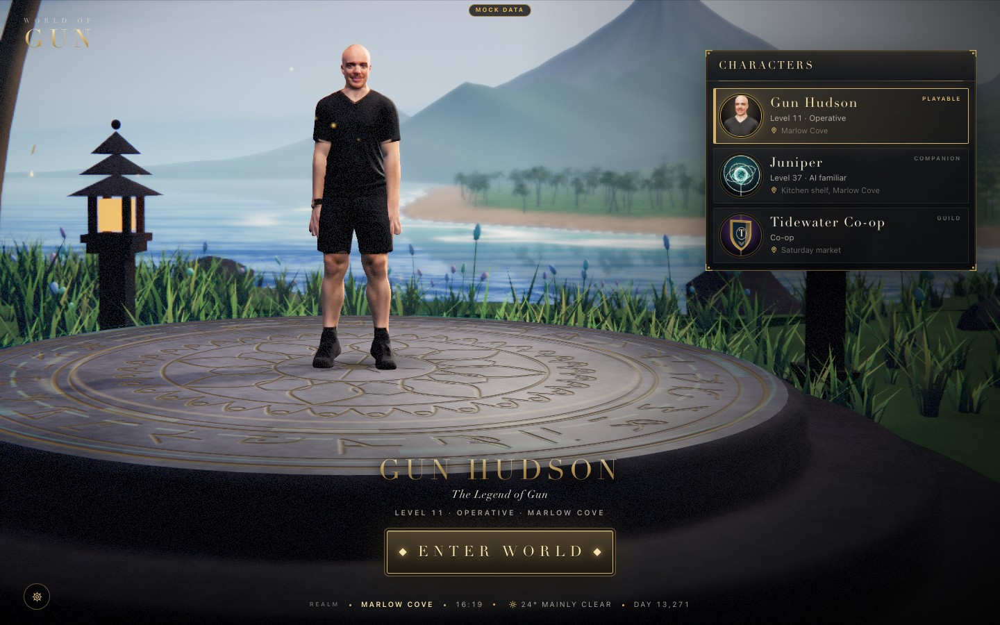

# World of Gun

Your real life as an MMORPG. A personal world wired to your own data: your body, money, tasks,
belongings, places and people drive a 3D character's level, bars and quests.

Built by [Gun Hudson](https://x.com/gunhudson) ([Instagram](https://instagram.com/gunhudson)). Open source under the MIT licence.



The screenshots use the demo data that ships with the repo (`?mock=1`). All demo values are invented sample data: the places, people, money, body numbers, belongings, dates and tasks in the mock are made up and describe nobody's real life.
Only the character's name and 3D model are real: they are Gun's own, included as the demo character.

## What it is

Not a game to play instead of your life. It is the interface for playing your life as the game:
you do things in the physical world, your devices and accounts record them, and the world shows the result.

- **Character select and world view.** A 3D character in a realm lit by the real sun position and weather of where you are.
- **Bars that mean something.** Health, energy, stamina and nine quick-glance meters, each computed from real readings.
- **Quests.** A main quest, dailies and weeklies that complete from data, and your open tasks as side quests.
- **Bags, wardrobe and outfits.** Your belongings as inventory, with outfits on the 3D body.
- **Treasury, party, needs, map, chronicle.** Balances and runway, the people in your life, a needs pyramid, everywhere you have been, and a graded history of every day.
- **Rule zero: nothing is invented.** A bar with no feed says "no signal". XP only comes from something a sensor, an account or a record saw.



## Where it came from

In February 2022 Gun posted [a thread on X](https://x.com/gunhudson/status/1496782040007540737)
asking: "if you were to design a 'computer game' for your life… what would your dashboard include?"
It came with a hand-drawn sketch: a rotating 3D character in the middle, a ONE THING quest box,
an inventory grid, a column of percentage bars, and a party tied to a personal CRM.
This repository is that sketch, built. `docs/DESIGN.md` has the design and the art direction.

## What is in the repository

| Path | What it is |
|---|---|
| `src/` | The engine: a Cloudflare Worker with one Durable Object. An append-only event log, a pure reducer that turns events into game state, the rules (XP, levels, bars, quests, streaks, day grades), and the HTTP API |
| `public/` | The client: a three.js stage (two realms, weather, day and night, activities, cameras) and the game interface, with no build step |
| `test/` | Engine tests, plain Node: `npm test` |
| `examples/collectors/` | Small example collectors that push facts from plain files (body measurements, balances, tasks, places) |
| `character/` | The pipeline that built the demo character from photos. It ships without source images: bring your own |
| `scripts/` | Smoke-tested deploy, a new-world generator, audio and cinematic renderers |
| `docs/` | Setup, the state contract, every event type, the client, multiplayer, and the design |

## Quick start

```bash
git clone https://github.com/gunhudson/world-of-gun.git && cd world-of-gun
npm install
cp .dev.vars.example .dev.vars
npx wrangler dev
```

Open `http://localhost:8787/?mock=1` for every screen with demo data, or `http://localhost:8787/`
for an empty, honest world. Then read [`docs/SETUP.md`](docs/SETUP.md): naming your world, sign-in
with Cloudflare Access, deploying, and feeding it real data.

## Making it yours

1. **Name it.** Set the world, player, companion and guild names, the skin and the realm in `wrangler.toml`, or run `scripts/new-world.sh` for a renamed copy without the demo character.
2. **Feed it.** Push events from whatever you already have: a scale, a watch, a bank export, a task list, a phone. Every event type is in [`docs/EVENTS.md`](docs/EVENTS.md). Test in a sandbox world before touching your real one.
3. **Tune the game.** The rules are tables in `src/rules.js`. The log is replayed from the start, so you can change a rule and your whole history is re-scored.
4. **Build your character.** Follow `character/README.md`, or keep the stand-in figure.
5. **Peer with friends.** Each person runs their own world and shares only a small signed card with the fields they choose. See [`docs/MULTIPLAYER.md`](docs/MULTIPLAYER.md). Sharing is off until you turn it on.



## Status

Young, and built for one person first. Expect rough edges:
there are two realms (`tropical-coast` and `dry-coast`), the body-shape mapping is approximate, the collectors are examples
and the native phone, watch and TV apps are not part of this repository. Issues and pull requests are welcome.

## Credits and licence

MIT, copyright Gun Hudson. See [`LICENSE`](LICENSE).
Third-party work (three.js, the stand-in figure, map outlines and others) is listed in [`THIRD-PARTY.md`](THIRD-PARTY.md).
The showcase film (`public/video/showcase.mp4`) and the audio were rendered from this code.
